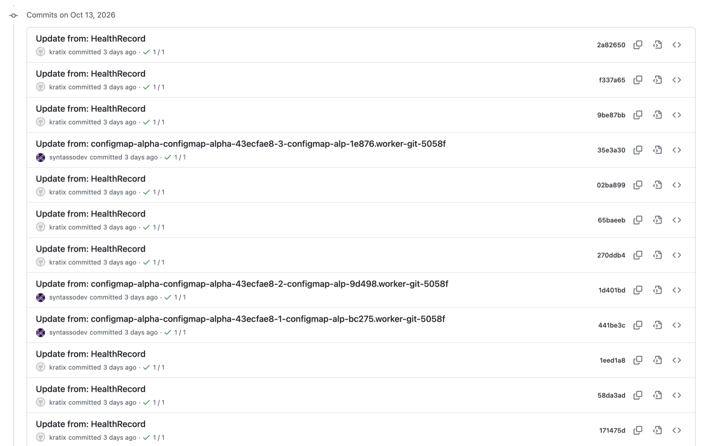

We love GitOps.

Kratix, a framework for building platforms on top of Kubernetes, has GitOps at its core, and it's a fundamental part of our recommended [platform architecture](https://docs.kratix.io/ske/reference/parts-of-a-platform). It’s what allows Kratix to schedule workloads to any type of Destination, what enables Compound Promises, and a central piece of the [declare-and-converge](https://notes.kodekloud.com/docs/Certified-Kubernetes-Administrator-CKA/Core-Concepts/Imperative-vs-Declarative/page) philosophy we follow.

But what happens when hundreds of commits are pushed in a short period? Or when customers want to know "who did that?", but the answer is buried under thousands of automated commits? Or even when you can't commit to the repository at all?

In this blog, we will cover how our health checks turned a GitOps repository into a commit firehose, why switching to buckets was not enough, and how the new Health Source in SKE puts the Platform back in control.

{/* truncate */}

---

## Why GitOps is great

First, what do we mean by GitOps? We roughly use the [GitLab definition](https://about.gitlab.com/topics/gitops/#what-is-git-ops):

> GitOps is an operational framework that applies DevOps practices like version control, collaboration, and CI/CD to infrastructure automation, ensuring consistent, repeatable deployments.

In more practical terms, it usually means having systems pass information through a store, which is often a Git repository. In a platform backed by Kratix, we rely heavily on the presence of those repositories to schedule and communicate information between clusters and different systems.

And to be fair that is one of the reasons our users love Kratix. It can do multi-cluster orchestration without the need to give the platform cluster direct access to the clusters running business Workloads. Furthermore, it is what enables Kratix to schedule any type of workload to any type of worker cluster, be they Kubernetes clusters, Ansible Towers, Terraform Workspaces, or just Jimmy’s machine executing a clone-apply-loop on a particular remote directory.

Beyond these benefits, GitOps enables Platform teams to:

- Have an audit trail of who did what and when (a.k.a. `git blame` with no shame)
- Keep a history of the changes for each individual resource, and an easy way to roll back a change that breaks
- Have a safe backup of what’s in the Platform; if it disappears overnight, all one needs to do is point a new cluster at the repository and the system will converge back to a healthy state

When the time came to design a health check system for Kratix, we needed a way for an external system to report back to the Platform about the state of a resource running *anywhere*. This can be a Deployment running on a Kubernetes destination, a database running in a Cloud Provider, or a VM wired up in an internal server. The constraint: the same way the Platform should not have direct access to the Destination, the Destination should not have direct access to the Platform.

The choice seemed obvious: we solved Platform → Destination with GitOps, so we could solve Destination → Platform the same way. The Destination runs the SKE Health Agent, and it is configured to write the health check records to a repository. The Platform is listening to that repository, and Kratix can react to the records as they are written.

Easy. Known. Shipped.

## A week later…



55,181 commits.

Fifty-five thousand one hundred and eighty-one commits. [In seven days](https://www.youtube.com/watch?v=cAixSVlYKKk).

That’s what we saw in our soak-test environment after enabling health checks on a handful of resources, each running every other minute. At this rate of commits, we started observing:

- An increase in conflicts: both the health agent and SKE are capable of recovering from weird git states, but it’s better when they don’t have to
- An increase in latency: more conflicts and a larger repository both contribute to an increase in the time it takes for a file to be written to that repository
- The commit log was no longer useful: of course, file-level `git log` was still fine, but we lost the ability to take a quick glance and find out what changed in the last hour, since we had several pages of just health updates
- Larger impact from misconfiguration: we had a Terraform workspace listening to the same repository and, albeit on a different directory, it was still running “terraform plan” for every health check being pushed. The plan queue was at 700 when we spotted the misconfiguration.

A lot of the problems above can be circumvented by *not* using Git as the health store, and our solution actually catered for that: you can use an S3-compatible bucket. The health agent writes to the bucket, your GitOps agent reads from the bucket… 🤝🏽

Except it doesn’t work if you are using ArgoCD, since it does not support reading from buckets. [And it might never do](https://github.com/argoproj/argo-cd/issues/12509). So… what can we do?

## Introducing Health Source

Well, what if we applied the resources ourselves? And that’s exactly what you can do [from SKE v0.59.0 onwards](https://docs.kratix.io/ske/releases/ske#v0590-2026-09-21), through a new type of State Store: a Health Source.

This new resource lets the SKE Platform Manager reconcile resources from a backing state store into the platform cluster. The SKE Health Agent already ships a writer (i.e. a piece of software that can write to both Git and buckets). The SKE Platform Manager now ships with an external store reconciler, responsible for reading the health records from the backing state store and applying them to the platform cluster.

What is supported as a Health Source, you may ask. If you guessed S3-compatible buckets (and Azure Blob Storage), you have been paying attention! Buckets are a great fit for this use case: simple to read and write, cheap to run and operate, and will not grow unbounded (unless you enable versioning…).

On the Platform, pointing SKE at the bucket the Health Agent writes to is a few lines of YAML:

```yaml
apiVersion: platform.syntasso.io/v1alpha1
kind: HealthSource
metadata:
  name: worker-1
spec:
  bucket:
    endpoint: s3.<AWS_REGION>.amazonaws.com
    bucketName: <BUCKET_NAME>
    authMethod: accessKey
    secretRef:
      name: health-store-reader
      namespace: default
  path: health
  pollInterval: 10m
```

The Platform Manager polls the bucket and applies whatever health records it finds under `health/`. Give it a read-only credential: the Destination is the only one that needs to write.

> Ah, but I am using Flux and that supports S3…

Excellent! No need to migrate or change it. You can continue to use Flux as your GitOps agent. In fact, we are not discontinuing writing to Git either: you can continue to write to Git if the issues we raised do not apply to you.

So which one should you pick?

- **You use ArgoCD**, or any GitOps agent that cannot read from buckets: write to a bucket and use a Health Source.
- **You run frequent checks across many resources**, **or the repository is shared with other automation**: move health records to a bucket, and read them with a Health Source or your existing Flux setup.
- **You have a handful of checks on a relaxed interval** and like having health history in Git: keep writing to Git.

Whichever you choose, choose one per set of records. Running a GitOps sync and a Health Source against the same records is only meant for migrations, and the [migration guide](https://docs.kratix.io/ske/guides/health-records-from-a-bucket) shows how to switch without a gap in health.

We migrated our environment to use this new feature, and things are sane again. We can actually check the git history. Commits are still under 56k. Reconciliation is faster. Life is good.

## Looking forward

But that’s only the beginning. What we really defined in SKE was a contract between the SKE Health Agent and the SKE Platform Manager. The agent writes, the manager reads. Taking control of when and how health records are applied not only addresses the issues we raised, but also allows us to do much more:

- Decide when to drop or ignore records:
  - As our CEO would say, the only certainty in distributed systems is that we can’t be certain. Things will break, the records in the Health Source might be dropped, overwritten, corrupted. The Platform Manager can now decide what to do when that invariably happens
- Keep our own system of records
  - How has the health of a particular resource changed over time? What’s the uptime of a resource or promise? How long does it take for a resource to report healthy?
- Expand the capabilities:
  - We can decorate, annotate, label, change the resources as they hit the platform. We could use that extra information within our integrations.
- Beyond simple storage: although it is our initial implementation, the contract opens up the possibility to bring new technologies.
  - What would it look like to have health checks delivered via Kafka or Redis? Can we integrate with observability tools to make our customers’ lives better?

Our creativity and our AI token allowance are really the limit! We would love to hear from you what the evolution of our health checks could look like, and what feature you would like to see next. Drop us a comment below, or come and chat with us in the [Kratix Slack](https://docs.kratix.io/main/community).

And as always, if you want to try this out, [request your SKE token](https://www.syntasso.io/pricing), head to the [Health Agent](https://docs.kratix.io/ske/installing-ske/ske-health-agent#features) documentation and give it a go!
