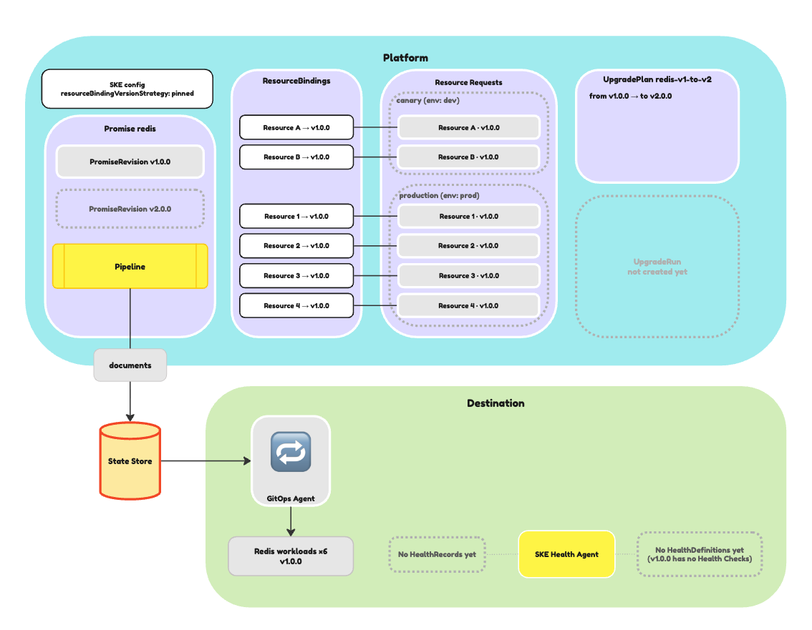
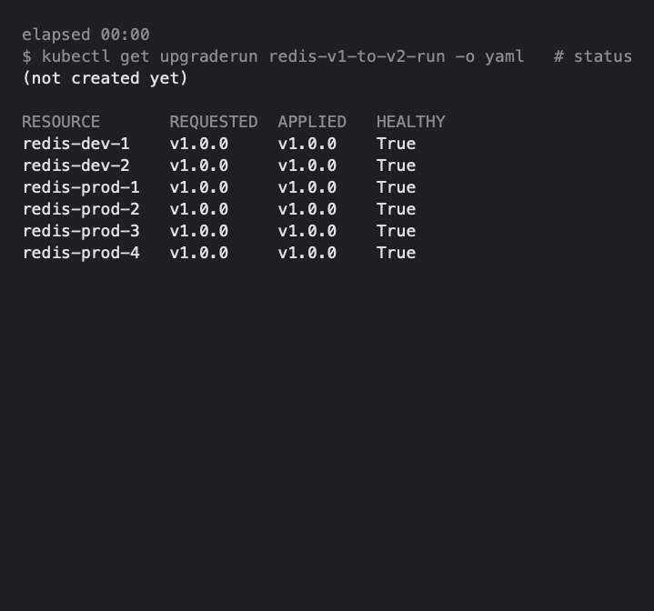

What does confidence in an upgrade look like? Seeing an upgrade applied? Seeing
that something is running at the expected version? Or is it knowing that
something is healthy following an upgrade? In the latest version of SKE,
v0.63.0, we've introduced health-informed upgrades. Now, an upgrade only moves
on when your Resource Requests pass their Health Checks.

{/* truncate */}

Since its inception, fleet management has been a core element of Kratix.
Running services for many users is hard. Without the right tooling, every new
instance adds to the load. And when it's time to patch or upgrade them all, the
job can be daunting.

Kratix was built to take that pain away; performing a change via a Promise
allows you to roll out that change to all instances of that Promise in one fell
swoop.

However, one fell swoop isn't the most reassuring strategy for platform teams.
We've seen the panic on customers' faces when we explain this. A bad Promise
version, rolled out everywhere at once, means at best a flood of tickets, and at
worst, taking down production.

Helping platform teams roll out new Promise versions with confidence has long
been on our roadmap. Over the last twelve months, we've released it in steps:

- [Promise Revisions and Resource Bindings](/blog/revision-and-bindings-announcement)
  to provide more control over which resources are upgraded
- [Upgrade Orchestrator](https://www.syntasso.io/post/introducing-upgrade-orchestration-safe-fleet-operations-for-enterprise-platforms)
  to pave the way for fine-grained control over _when_ upgrades happen

And now, health-based criteria for whether an upgrade should proceed.

## How Upgrade Runs began

Once upon a time, we introduced
[Upgrade Plans for SKE](/ske/reference/promise-upgrades/upgrade-plans). These
let you split an upgrade into Rollout Groups. When one group succeeded, the
upgrade moved on to the next, even if every Health Check for the upgraded
resources had failed. Success was whether the pipelines ran to completion; no
attention was paid to whether the resources were healthy.

Pipelines running to completion is one measure of success, but not enough for
all use cases.

## An overview of health-informed Upgrade Runs

As of SKE v0.63.0, you can use the results of Health Checks to determine
whether a group has upgraded successfully and whether to proceed with the next.

To turn it on, set `successCriteria` on a rollout group in your `UpgradePlan`:

```yaml
rolloutGroups:
  - name: canary
    selectors:
      matchLabels:
        env: dev
    maxConcurrent: 1
    # highlight-start
    successCriteria: healthCheck
    healthTimeout: 15m
    # highlight-end
```

With `successCriteria: healthCheck`, the run waits for every canary resource to
pass its Health Checks at the new version before it moves on. If a resource
reports unhealthy, or doesn't pass within the (in this example) 15-minute
`healthTimeout`, the run fails and the next group never starts.

Don't have any Health Checks for your Promise? Fear not, this feature is
opt-in. If you don't yet have any Health Checks configured, you can omit the
`successCriteria` key or set it to `pipeline` to continue to use pipeline
success as the criteria.

## Using health-informed Upgrade Runs

Health-informed upgrades depend on the SKE Health Agent, which runs your Health
Checks on each Destination and reports the results back to the platform. In the
following example, we're illustrating how a Redis Promise can roll out from
v1.0.0 to v2.0.0. A canary group of resources is upgraded first, and the run
only moves on to the other groups once the canary resources pass their Health
Checks.

### Prerequisites

- SKE v0.63.0 or later
- SKE configured with `resourceBindingVersionStrategy` set to `pinned`
- A versioned Promise
- Resources that are pinned to a version through their Resource Bindings
- The SKE Health Agent (v0.16.0 or later) installed on all required
  Destinations

:::warning

If a Destination has no Health Agent, its results never arrive. Its resources
wait until the timeout runs out, and then the Upgrade Run fails. Any group that
schedules to these Destinations should stay on the default pipeline criteria.

:::

### Adding Health Checks to the new Promise version

In this example, we have a Redis Promise with two Promise Revisions, v1.0.0 and
v2.0.0. All of the Resource Requests are bound to v1.0.0.



To introduce Health Checks to the Promise, we can add a container that writes a
`HealthDefinition` to the `resource.configure` workflow of the new version of
the Promise:

```yaml
apiVersion: platform.kratix.io/v1alpha1
kind: Promise
metadata:
  name: redis
  labels:
    kratix.io/promise-version: v2.0.0
spec:
  workflows:
    resource:
      configure:
        - apiVersion: platform.kratix.io/v1alpha1
          kind: Pipeline
          metadata:
            name: instance-configure
          spec:
            containers:
              - image: ghcr.io/syntasso/kratix-marketplace/redis-configure-pipeline:v0.1.0
                name: redis-configure-pipeline
              # highlight-start
              - image: ghcr.io/syntasso/kratix-docs/redis-health-checks:v0.1.0
                name: generate-healthdefinition
                command: [ "write-definition" ]
              # highlight-end
```

Applying this Promise creates a new `PromiseRevision` at version `v2.0.0`. The
pinned resources stay on v1.0.0 until an Upgrade Run moves them.

### Defining the Upgrade Plan

To upgrade Resource Requests to this Promise version, we can define an Upgrade
Plan that first upgrades a canary group of resources before rolling the upgrade
out to production.

In the Upgrade Plan, we set `successCriteria: healthCheck` on the canary group,
then choose a `healthTimeout` that's comfortably longer than the gap between
Health Check runs:

```yaml
apiVersion: platform.syntasso.io/v1alpha1
kind: UpgradePlan
metadata:
  name: redis-v1-to-v2
spec:
  promiseRef:
    name: redis
  upgradePath:
    from:
      - "v1.0.0"
    to: "v2.0.0"
  rolloutGroups:
    - name: canary
      selectors:
        matchLabels:
          env: dev
      maxConcurrent: 1
      # highlight-start
      successCriteria: healthCheck
      healthTimeout: 15m
      # highlight-end
    - name: production
      selectors:
        matchLabels:
          env: prod
      maxConcurrent: "25%"
```

### Running the upgrade

We can trigger an upgrade by creating an Upgrade Run:

```yaml
apiVersion: platform.syntasso.io/v1alpha1
kind: UpgradeRun
metadata:
  name: redis-v1-to-v2-run
spec:
  upgradePlanRef:
    name: redis-v1-to-v2
```

As it runs, we can look at the run's status to see how it progresses:



The canary group's `awaitingHealth` count shows how many resources have reached
v2.0.0 but haven't yet passed their Health Checks. In this example, one canary
resource has passed and one is still waiting. `production` is yet to start.

Once every canary resource passes, the run moves on to `production`. When the
run finishes, the state transitions to `Completed`.

If a canary resource reports unhealthy, or doesn't pass within `healthTimeout`,
the run stops straight away. The `production` group is never touched.

With the new health-informed upgrades, you can now be even more confident that
your upgrades are safe and that your platform provides a consistent service for
your users.

## Want to try it out?

You can try health-informed upgrades in the latest version of SKE.

- Take a look at [our documentation](/ske/guides/healthchecks) to see how to
  write Health Checks for your Promises
- Review our guide to managing [Promise upgrades](/ske/guides/promise-upgrades)
