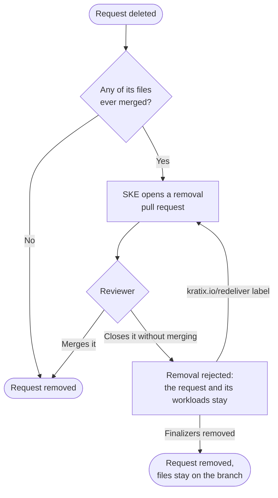

# Pull request delivery

With pull request delivery, SKE opens a pull request for each change to a
`GitStateStore` instead of pushing to its branch directly. To enable pull
request delivery for a `GitStateStore`, see [Set up pull request
delivery](/ske/operations/pull-request-delivery).

## Configuring

```yaml
apiVersion: platform.kratix.io/v1alpha1
kind: GitStateStore
metadata:
  name: production
spec:
  # url, branch, authMethod and secretRef as usual
  delivery:
    mode: pullRequest
    config:
      provider: github
      checkInterval: 30s
      apiURL: https://github.example.com/api/v3
```

The `delivery` block has the following fields.

### mode

Required. Set it to `pullRequest`.

### config

The settings for the Git server that SKE opens pull requests on.

#### provider

Required. One of:

- `github`, for github.com and GitHub Enterprise Server.
- `azureDevOps`
- `gitlab`

#### checkInterval (default: 30s) {#check-interval}

How often SKE checks each open pull request, as a duration such as `30s` or
`2m`. SKE notices a merged or closed pull request at its next check.

#### apiURL

GitHub and GitLab only. The provider's API address. It must be on the same host
as `spec.url`.

- On GitHub, it defaults to `https://api.github.com` for github.com, and
  `https://<host>/api/v3` for any other host.
- On GitLab, it defaults to `https://<host>/api/v4`. Set it when GitLab is
  installed under a path, for example `https://git.example.com/gitlab/api/v4`.

## Limitations

- `authMethod: ssh` is not supported, because SKE needs a token to call the
  provider's API. On GitHub, use `basicAuth` or `githubApp`. On Azure DevOps,
  use `basicAuth` with a personal access token as the `password`, and any
  `username` that is not empty. On GitLab, use `basicAuth` with an access token
  as the `password`, and any `username` that is not empty.
- On Azure DevOps, `spec.url` must be
  `https://dev.azure.com/<ORGANISATION>/<PROJECT>/_git/<REPOSITORY>` or
  `https://<ORGANISATION>.visualstudio.com/<PROJECT>/_git/<REPOSITORY>`.
- On GitLab, `spec.url` must be `https://<HOST>/<GROUP>/<PROJECT>`, with any
  number of subgroups. The access token needs the `api` and `write_repository`
  scopes, and its user needs at least the Developer role on the project. Deploy
  tokens do not work, because they cannot call GitLab's API.
- SKE is tested with gitlab.com. It accepts a self-managed GitLab, which is not
  tested.
- Destinations with `filepath.mode: aggregatedYAML` are not supported.

## Turning it on and off

- **Adding the `delivery` block** to a `GitStateStore` that already has requests
  opens a pull request only for requests whose files differ from the
  Destination's branch.
- **Removing the `delivery` block** makes SKE write every request straight to
  the Destination's branch again, including requests waiting for approval or
  rejected. A rejected removal stays rejected (see [Deleting](#deleting)). SKE
  does not close the pull requests that were open. You must close them yourself.

## Status

The request's `STATUS` column shows a summary of the change, cut to 120
characters. `kubectl describe` shows the full text in the `Reconciled` and
`WorksSucceeded` conditions.

| `STATUS` | Meaning |
| --- | --- |
| `Waiting for approval: <URL>` | A pull request is open. |
| `Rejected in <URL>: "<COMMENT>"` | A reviewer closed the pull request with a comment. |
| `Rejected in <URL> with no comment` | A reviewer closed the pull request without a comment. |
| `Waiting for approval to remove: <URL>` | The request was deleted and its removal pull request is open. |
| `Removal rejected; the workloads are still on <DESTINATION>. Rejected in <URL>...` | A reviewer closed the removal pull request without merging it. |

SKE quotes the comment the reviewer left when closing the pull request, up to
500 characters:

- On GitHub, it quotes the **Close with comment** text. It does not quote review
  comments.
- On Azure DevOps, it quotes the latest comment by the person who abandoned the
  pull request, written within a minute before or after they abandoned it.
- On GitLab, it quotes the latest comment by the person who closed the merge
  request, written within a minute before or after they closed it.

Anyone who can read the resource request can read the quote and the link, even
without access to the repository.

The condition reasons are:

| Resource | Condition | Open | Merged | Closed without merging |
| --- | --- | --- | --- | --- |
| Resource request | `Reconciled` | `WorksAwaitingDelivery` | `Reconciled` | `WorksRejected` |
| Work | `WriteSucceeded` | `WorkplacementsAwaitingDelivery` | `WorkplacementsWritten` | `WorkplacementsRejected` |
| WorkPlacement | `WriteSucceeded` | `WorkloadsAwaitingDelivery` | `WorkloadsWrittenToStateStore` | `WorkloadsRejected` |

The condition's status is `Unknown` while a pull request is open, `True` once
merged, and `False` once closed without merging. Each WorkPlacement also holds
its pull request's link in `status.deliveryURL`, and `status.deliveryRemoval` is
`true` when it is a removal. A Work's `status.workPlacementStatuses` lists each
WorkPlacement with its Destination, status and `deliveryURL`.

## How SKE handles pull requests

SKE opens each pull request from a `kratix/<WORKPLACEMENT_NAME>` branch into the
Destination's branch, and checks it every `checkInterval`. Azure DevOps calls a
merged pull request **completed**, and one closed without merging **abandoned**.
GitLab calls a pull request a **merge request**.

| When | SKE |
| --- | --- |
| The pull request is merged | Marks the change as done, and runs the request's next pipeline. |
| The pull request is closed without merging | Marks the request as rejected, and does not run its later pipelines. It does not open a pull request for the same files again until you retry. |
| The request changes and produces different files | Closes the open pull request and opens a new one. Reviews do not carry over. |
| The request changes but produces the same files | Keeps the open pull request and its reviews. |
| The request changes back to what is already merged | Closes the pull request, because it is no longer needed. The request becomes ready. |
| The pull request has merge conflicts | Rebuilds it on top of the latest Destination's branch, keeping its number and link. Depending on your branch rules, existing approvals may be dismissed: on GitHub, "Dismiss stale pull request approvals when new commits are pushed"; on Azure DevOps, the "When new changes are pushed" policy; on GitLab, the "Remove all approvals" approval setting. On Azure DevOps, SKE needs permission to force-push its branches, which their creator has unless a branch permission removes it. On GitLab, a protected branch rule that covers `kratix/*` must allow force pushes. SKE does not touch a pull request that is only behind, has failing checks, or whose conflicts you resolved yourself. |
| Someone changes a `kratix/<WORKPLACEMENT_NAME>` branch | Overrides the changes. |
| Someone changes SKE's files on the Destination's branch | Opens a new pull request to put them back. |

To retry a rejected change, label the request's Work with
`kratix.io/redeliver=true`. After a rejected pull request, SKE opens a new one.
After a rejected removal, it opens a new removal pull request. Otherwise it does
nothing, unless the files on the Destination's branch have changed.

## Deleting

Deleting a request opens a removal pull request that removes its files from the
Destination's branch. The request is only removed when that pull request is
merged:



- If the request still has an open pull request, SKE closes it before opening
  the removal pull request.
- Deleting a Promise waits for the removal pull request of every request. One
  rejected removal keeps the Promise.
- Deleting a Destination with `cleanup: all` waits for a removal pull request
  for each of its WorkPlacements. With `cleanup: none`, SKE leaves the files on
  the branch.

To remove a request and leave its files on the Destination's branch, remove the
finalizers from its WorkPlacements:

```bash
kubectl get workplacements --all-namespaces \
  -o custom-columns=NAMESPACE:.metadata.namespace,NAME:.metadata.name,REQUEST:.spec.resourceName \
  | grep <RESOURCE_NAME>

kubectl patch workplacement <WORKPLACEMENT_NAME> -n <NAMESPACE> \
  --type=json -p='[{"op": "remove", "path": "/metadata/finalizers"}]'
```

## Related docs

- [Set up pull request delivery](/ske/operations/pull-request-delivery)
- [GitStateStore](/main/reference/statestore/gitstatestore)
- [Work status and
  events](/main/platform-concepts/kratix-resources/work-status-events)
